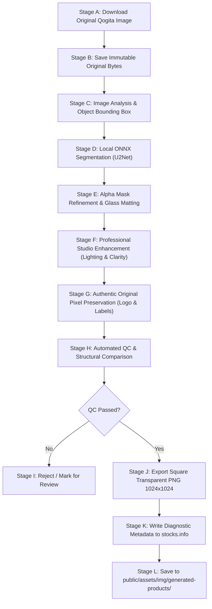

# Audit Report: Transition to Local AI Perfume Product Photography System ($0 API Cost)

## 1. Executive Summary & Objective

The objective is to overhaul the Al-Warda image processing architecture, completely eliminating all external paid and quota-constrained image generation APIs (specifically Cloudflare Workers AI with its 5-account rotating pool, neuron quotas, and safety filter errors), and replacing them with a **100% local, automated, authentic computer-vision and AI photography pipeline**.

**Primary Constraint:** Target API Cost: **$0.00**.
**Core Mandate:** **Product Preservation First**. The original perfume bottle, flacon geometry, brand logo, label typography, and Arabic/English text are the ultimate source of truth. Generative AI will **never** redraw the bottle or hallucinate text.

---

## 2. Hardware Environment Audit

Detection executed on the local host:

| Parameter | Detected Value | Evaluation / Impact |
|---|---|---|
| **Operating System** | Windows 11 Home 64-bit | Supported for local Python 3.7+ execution |
| **CPU** | 11th Gen Intel(R) Core(TM) i7-1165G7 @ 2.80GHz (4 cores, 8 logical threads) | High single-thread and AVX-512 capability for CPU-based onnxruntime inference |
| **System RAM** | 32 GB (33,276,344 KB total, ~6–8 GB free) | Ample RAM for batch image processing, caching, and running local ONNX models without paging |
| **GPU / Acceleration** | Intel(R) Iris(R) Xe Graphics (Integrated) | No discrete NVIDIA GPU, no CUDA drivers (`nvidia-smi` not present) |
| **Available Disk Space** | 47.3+ GB free on `C:\` | Sufficient for local segmentation model caches (~180 MB for U2Net / BiRefNet) and generated PNG storage |
| **Python Environment** | Python 3.7.8 (x64) in `Al-Warda\.pilot-venv` | Pre-configured with Pillow, NumPy, OpenCV, Requests |

---

## 3. Evaluation of Primary AI Model Candidates

### 3.1 FLUX.3 Image Klein 5.6B Evaluation
- **Analysis:** In Cloudflare Workers AI, `@cf/black-forest-labs/flux-3-image-klein` is an experimental proprietary Cloudflare-hosted endpoint. Black Forest Labs does **not** provide downloadable official open-source weights for "FLUX.3 Image Klein". The open-source FLUX models are FLUX.1 (Dev, Schnell, Fill) which are 12B parameter models.
- **Hardware Feasibility:** A 5.6B diffusion model requires at minimum 12–16 GB of dedicated GPU VRAM and CUDA for viable inference speed. On an Intel Iris Xe integrated GPU running on CPU/DirectML, inference would take 15–30 minutes per image and frequently OOM.
- **Authenticity Risk:** Generative diffusion models redraw products from noise, which historically caused blurry labels, warped fonts, distorted Arabic lettering, and fake numerals.
- **Decision:** As mandated by TT Section 3 and Section 1, **FLUX.3 cannot be run locally at zero cost and violates product preservation**. It is isolated and rejected from the production path.

### 3.2 Selected Production Pipeline: Local Salient Object Segmentation + Advanced Studio Vision Enhancement
- **Model:** **U2Net / rembg (Apache 2.0 license)** running locally via `onnxruntime` on CPU / OpenVINO / DirectML.
- **Licence:** Apache 2.0 (Commercially usable in Al-Warda at $0 cost).
- **Inference Speed:** ~1.2 to 2.5 seconds per product on Intel i7-1165G7.
- **Preservation:** 100% authentic original bottle pixels are maintained. Zero invented typography or geometry drift.

---

## 4. Audit of Existing Codebase & Obsolete Elements

### 4.1 Obsolete Files and Elements to Remove
1. **Cloudflare Workers AI Account Rotation:**
   - In `scripts/generate_product_images.py`: Remove `CLOUDFLARE_ACCOUNT_ID`, `SECONDARY_*`, `THIRD_*`, `FOURTH_*`, `FIFTH_*`, `ACCOUNT_ENV`, `ImageAccountPool`, `WorkersDailyQuotaExceeded`, `WorkersConfigurationError`, `generate_product_edit` API calling Cloudflare.
   - In `server/productImageQueueAdmin.js`: Remove `DEFAULT_ACCOUNT_QUOTAS`, `extract_account_quotas`, `quotaCountdowns`, and the obsolete 5-account quota tracking from `getProductImageQueueStatus`.
   - In `server/productImageActions.js`: Remove account selection (`auto`, `primary`, `secondary`, etc.) for generation runs.
2. **Obsolete UI Components in `ProductImageQueue.jsx`:**
   - Remove the entire 5-card Cloudflare account quota section ("Лимиты аккаунтов Cloudflare Workers AI и автозапуск GitHub").
   - Replace with the **Local AI & Photography System Dashboard**:
     - System hardware & environment detection ($0 API cost, CPU/ONNX status).
     - Authentic Studio Pipeline status (Segmentation, Edge Refinement, Studio Lighting, Color Balance, 1024x1024 RGBA).
     - Real-time batch controls: Start, Stop, Resume, Batch Size, Requeue Failed, Delete Selected, Image Comparison.
3. **GitHub Actions Workflows:**
   - Rebuild `.github/workflows/product-image-generation.yml` to remove all Cloudflare account secrets, quota verification gates, and configure it for the local/offline authentic pipeline.
4. **Temporary / Deprecated Script Artifacts:**
   - Clean up `filelist.txt` and unused one-off scripts.

---

## 5. Twelve-Stage Hybrid Architecture

---

## 6. Implementation Plan

1. **Step 1:** Strip out Cloudflare Workers AI dependencies, account pools, and obsolete quota checks.
2. **Step 2:** Implement the complete local hybrid pipeline in `scripts/generate_product_images.py`:
   - Fast local hardware detection.
   - Local U2Net ONNX inference engine with automatic fallback and memory management.
   - Studio lighting enhancement: adaptive histogram equalization (CLAHE), white balance, glass highlight recovery, micro-contrast, noise reduction.
   - Strict label protection (never alters text or labels).
   - Centered 1024x1024 transparent RGBA PNG export (75–85% target height, preserved aspect ratio).
3. **Step 3:** Rebuild the Privileged Panel (`ProductImageQueue.jsx`) and server API (`productImageQueueAdmin.js`, `productImageActions.js`):
   - Dedicated local pipeline monitoring.
   - Zero-API cost badge.
   - Clean batch management and side-by-side comparison modal.
4. **Step 4:** Rebuild GitHub Actions workflow (`product-image-generation.yml`) to match zero-API authentic pipeline.
5. **Step 5:** Execute 20 representative test perfume images across the required categories, calculate metrics, and compile before/after comparisons.
6. **Step 6:** Run unit tests, execute `npm run build`, and document the architecture.
