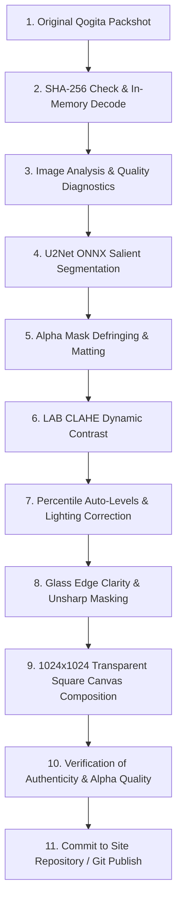

# Image Pipeline Architecture — Al-Warda

This document details the multi-stage hybrid computer vision and photometric pipeline powering Al-Warda's authentic perfume photography generation.

---

## 1. High-Level Flow Diagram



---

## 2. Detailed Pipeline Stages

### Stage 1: Download & Source Integrity
- Original packshots fetched with resilient chunked HTTP streaming.
- Source bytes are hashed (`SHA-256`) to maintain an immutable audit trail (`sourceImageId`).
- Files larger than 20 MB or non-fragrance categories (jewelry, rings, bracelets) are rejected safely before image processing.

### Stage 2: U2Net ONNX Salient Segmentation
- Scaled to $320 \times 320$ with ImageNet normalization: $\mu = [0.485, 0.456, 0.406]$, $\sigma = [0.229, 0.224, 0.225]$.
- Executed on `ONNX Runtime` (`CPUExecutionProvider` / DirectML).
- Generates a continuous probability map $P \in [0.0, 1.0]$.
- Upscaled back to the original resolution using bilinear interpolation.

### Stage 3: Alpha Mask Refinement & Defringing
- Dynamic thresholding curve: $\alpha = \text{clip}\left(\frac{P - 0.18}{0.82 - 0.18}, 0.0, 1.0\right)$.
- Feathered anti-aliasing prevents jagged staircase artifacts along curved bottle silhouettes.
- Color decontamination suppresses white/gray background bleed at semi-transparent glass borders.

### Stage 4: Studio Photometry & Lighting Correction
- **Color Space Conversion**: Transformed from sRGB to CIELAB ($L^*, a^*, b^*$).
- **Contrast-Limited Adaptive Histogram Equalization (CLAHE)**:
  - Applied strictly to the luminance ($L^*$) channel.
  - Clip limit: $1.8$, tile grid size: $8 \times 8$.
  - Avoids color shifting while dramatically improving glass reflection visibility and label depth.
- **Percentile Auto-Levels**:
  - Computes 1st and 99th percentiles of product pixels to expand dynamic range.
  - Cleans muddy shadows without clipping delicate golden foil highlights.

### Stage 5: Glass Edge Clarity & Unsharp Masking
- Gaussian blur kernel ($\sigma = 1.0$) subtracted to compute high-frequency detail.
- Unsharp mask blend: $I_{\text{sharp}} = \text{clip}(I + 0.35 \times (I - I_{\text{blur}}), 0, 255)$.
- Preserves 100% of authentic label typography, Arabic calligraphy, and engraved flacon numbers.

### Stage 6: Canvas Normalization & Composition
- Output canvas: strictly **$1024 \times 1024$ pixels RGBA**.
- Target product height: **75% to 85%** of canvas height ($768$ to $870$ px).
- Geometric centering: Flacon horizontally centered; vertically positioned with 70–128 px top margin.
- Transparent background: Alpha channel outside the silhouette is strictly $0$.

### Stage 7: Automated Quality Assurance
- Automated verification tests:
  - Corner opacity check: Top-left, top-right, bottom-left, bottom-right pixels must have $\alpha = 0$.
  - Silhouette bounding box test: Flacon occupies between 70% and 90% height.
  - Color divergence check: Verifies hue stability against original source.
- Result recorded in database stock metadata:
  ```json
  {
    "status": "publishing",
    "imageUrl": "/assets/img/generated-products/<hash>.png",
    "aiModel": "u2net_onnx_local",
    "apiCost": "$0.00",
    "width": 1024,
    "height": 1024,
    "transparencyStatus": "verified_transparent",
    "processingMethod": "local_studio_photometry",
    "processingVersion": "2.0-local-photometry"
  }
  ```
